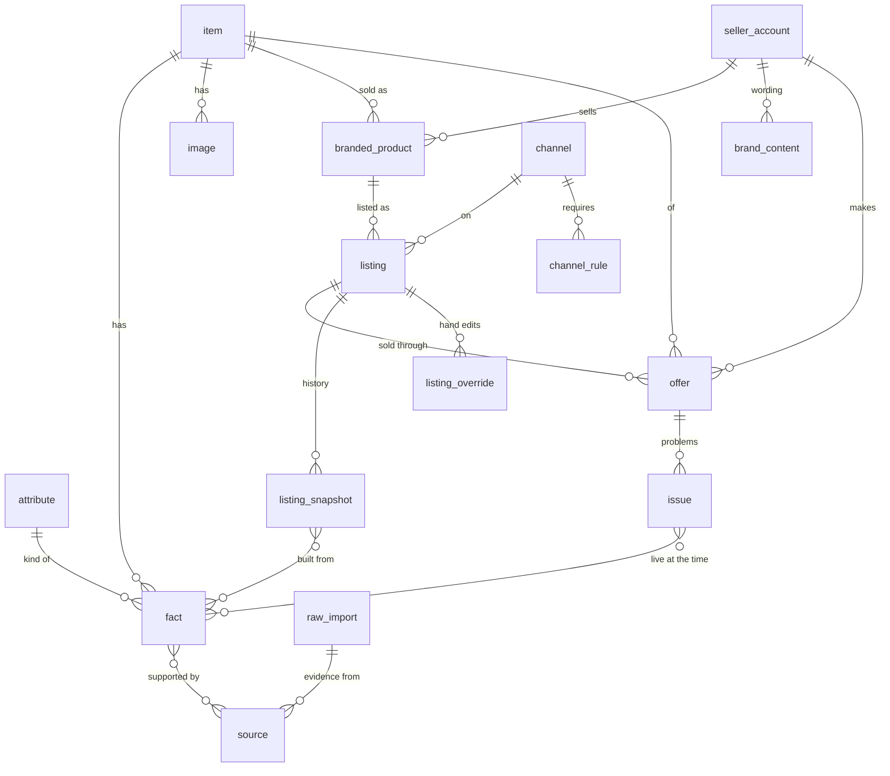

# PIM schema, draft 1

20 November 2026. For review. Nothing here has been created in a database or
deployed to NetSuite yet.

- `db/schema.sql`: the Postgres tables
- `netsuite/src/Objects/customrecord_pim_offer.xml`: the NetSuite offer record

## The idea: facts as rows, not columns

Today's Ecom Record is a **wide** table: 391 columns, one per piece of
information. Every new kind of information means a new column, and a column
can hold a value but not where the value came from.

The PIM's `fact` table is **narrow** (also called tall or long). Each row is
one statement about one item:

| item | attribute | make | value | status |
|---|---|---|---|---|
| 897788M91 | part_type | | Hood latch assembly | approved |
| 897788M91 | replaces_part_number | Massey Ferguson | 182367M1 | approved |
| 897788M91 | fits_model | Massey Ferguson | 135 | approved |
| 897788M91 | fits_model | Massey Ferguson | 65 | proposed |
| 897788M91 | fits_model | Massey Harris | 50 | approved |

The professional name for this is the **entity-attribute-value** pattern,
usually shortened to EAV: the entity is the item, the attribute is the kind of
fact, the value is what we believe.

What it buys:
- A new kind of fact is a new row in `attribute`. No schema change.
- Every value can carry its own source, confidence, approval and history.
- Items only have rows for facts that apply to them.

What it costs:
- Questions like "show me the item with all its facts side by side" take more
  work to ask than reading one wide row.
- The database cannot check much about a value's shape; the application has to.

So the design is a hybrid. Things with a fixed, known shape are ordinary
tables with ordinary columns (`item`, `offer`, `listing`). Only the open-ended
part, what we know about a part, is rows.

`channel_rule` uses the same trick for a different reason: what a channel
requires is one row per field, so a new Amazon requirement is a new row.

## The tables

| Group | Table | One row is |
|---|---|---|
| Reference | `seller_account` | A seller account ("Sold by"), with its brand name |
| | `brand_content` | A piece of brand wording, such as warranty text |
| | `channel` | A sales channel |
| | `attribute` | A kind of fact, and whether it needs human approval |
| What we know | `item` | A physical part, mirrored from NetSuite |
| | `raw_import` | Data exactly as it arrived, before interpretation |
| | `source` | A piece of evidence |
| | `fact` | One statement about one item |
| | `fact_source` | A link between a fact and a piece of evidence |
| | `image` | A picture of an item, with role and approval |
| What we sell | `branded_product` | An item as sold by one account from one angle |
| | `listing` | One page on one channel |
| | `offer` | Our sale on a listing, mirrored from NetSuite |
| Channel | `channel_rule` | One field a channel wants, with its limits |
| | `listing_override` | A hand-written value for one field of one listing |
| | `listing_snapshot` | A frozen copy of a listing at one moment |
| | `listing_snapshot_fact` | A fact version used to build a sent snapshot |
| After the sale | `issue` | A problem raised by customer service |
| | `issue_fact` | A fact that was live when the problem order was placed |

## Choices worth knowing about

- **Facts are never edited.** A correction adds a new row pointing at the one
  it replaces, and the old row's status becomes `retired`.
- **Each fitment value is its own fact.** "Fits model 135" and "fits model 65"
  are separate rows, so one can be approved, questioned or retired without
  touching the other.
- **Negative facts exist.** `is_negative` records "does not fit" and "not
  interchangeable", such as the vendor part marked "do not use" on the latch.
- **`raw_import` keeps the original.** The 55 Ecom Records for the latch load
  here untouched. Facts built from them point back through `source`.
- **Listing content is not stored as a table of fields.** It is assembled from
  facts when needed. What was sent is kept whole in `listing_snapshot`.
- **Offer uniqueness is enforced here.** NetSuite cannot enforce "unique on
  account + channel + SKU" on its own, so the PIM rejects a duplicate and
  writes the reason back to the offer's message field.
- **Channel rules are marked `is_assumed`** until confirmed against the
  channel's real schema.

## The NetSuite offer record

`customrecord_pim_offer`, 16 fields, IDs prefixed `custrecord_pim_ofr_`.
Offers number themselves `OFR-000001` and up.

| Field | Type | Filled by |
|---|---|---|
| Item | Link to item (required) | Person |
| Seller Account | Link to eCommerce Accounts (required) | Person |
| Channel | Text (required) | Person |
| Variant | Text | Person |
| Seller SKU | Text (required) | Person |
| Price | Currency | Pricing team |
| Fulfilment | Text | Person |
| Shipping Template | Text | Person |
| Active | Checkbox, off by default | Person |
| Listing Type | Text | Person |
| Brand on Listing | Text | PIM |
| Channel ID | Text | Person (joined) or PIM (owned) |
| PIM Status | Text | PIM |
| PIM Message | Long text | PIM |
| PIM Link | URL | PIM |
| Last Synced | Date and time | PIM |

Access: unlike the Ecom Record, a role needs the Custom Record Entries
permission to see or edit offers.

Because Item is marked as the parent, offers will appear as a list on the item
record.

## Left out of the prototype on purpose

- Users, roles and permissions inside the PIM
- A publish queue with retries
- Vendor-level trust scores
- Structured equipment tables (makes and models as their own records)
- Price floor and ceiling, quantity rules

Each can be added without disturbing the tables above.
